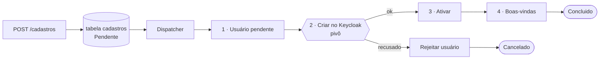

# Cadastro de usuário com Keycloak: uma saga com Temporal

Exemplo da parte prática do tech talk sobre o **Saga Pattern**, desenhado como seria em produção.

**O problema.** Cadastrar um usuário exige gravar no banco da aplicação **e** criar a identidade dele no Keycloak (no caso original, o Amazon Cognito). Nenhuma transação cobre os dois: se um der certo e o outro falhar, o usuário fica pela metade.

**A solução.** O cadastro vira uma saga orquestrada pelo [Temporal](https://temporal.io). Cada passo é uma activity; o Temporal guarda o histórico, repete o que falhou por motivo técnico e, se o Keycloak recusar o cadastro de vez, a saga desfaz o que já tinha feito.

## O fluxo

| # | Passo | Tipo | Se falhar |
|---|---|---|---|
| 1 | Gravar o usuário como `Pendente` | compensável | username já usado: a saga termina `Cancelado`, sem nada para desfazer |
| 2 | Criar o usuário no Keycloak | **pivô** | falha temporária: o Temporal tenta de novo. Username ou e-mail já existente no Keycloak: compensa o passo 1 |
| 3 | Marcar o usuário como `Ativo`, com o id do Keycloak | repetível | o Temporal tenta de novo |
| 4 | Enviar o e-mail de boas-vindas | repetível | o Temporal tenta de novo |
| C1 | Marcar o usuário como `Rejeitado`, com o motivo | compensação de 1 | o Temporal tenta de novo |



O **perfil padrão** (papel `cliente`) não é um passo da saga: é o *default role* do realm, e o próprio Keycloak o aplica a todo usuário novo.

## Por que um serviço só, em dois containers

O cadastro envolve dois recursos, o banco e o Keycloak. Quem orquestra é o dono do processo, o próprio serviço de cadastro. Separar em microsserviços, pôr um broker no meio ou criar um serviço só para chamar a API do Keycloak acrescentaria rede, falhas e operação sem resolver nada a mais.

O serviço roda em **dois containers**, construídos da mesma solution:

| Container | Projeto | O que faz |
|---|---|---|
| `cadastro-web` | `CadastroService.Web` | A API REST: registra o cadastro como `Pendente` e consulta o estado, tudo no Postgres. Não conhece a saga nem o Temporal |
| `cadastro-worker` | `CadastroService.Worker` | O dispatcher (entrega os cadastros pendentes à saga) e o worker do Temporal: busca as tarefas na task queue `cadastro` e executa o workflow e as activities. Aplica as migrations ao subir |

Separar os dois permite escalar cada um conforme a carga: mais réplicas do worker não mudam nada na API, e o Temporal distribui as tarefas entre elas. A web fala só com o Postgres; o worker fala com o Postgres, o Temporal, o Keycloak e o SMTP. Os dois containers nunca falam entre si: a **tabela `cadastros` é o elo** entre eles.

O que importa na saga:

- **Estado da saga:** na tabela `cadastros` (estado atual, histórico, motivo e id no Keycloak). Cada passo é gravado pela activity `RegistrarPasso`, e `GET /cadastros/{id}` lê essa tabela; a query do Temporal não é usada. O histórico de execução (tentativas, repetições) fica no Temporal e aparece na Temporal UI. O status do usuário (`Pendente`, `Ativo`, `Rejeitado`) é o reflexo dele no banco e serve de **trava semântica**: um usuário pendente não pode ser excluído (409).
- **Retry:** política `StepPolicy` (`Application/Features/ProcessarCadastro/StepPolicy.cs`): timeout de 30 s por passo e espera exponencial de 200 ms a 10 s, sem limite de tentativas para falhas técnicas. Só uma recusa de negócio (`StepRefusedException`) interrompe.
- **Idempotência:** o Temporal pode repetir uma activity. Criar o usuário duas vezes não duplica; se o Keycloak responder "já existe" com o mesmo username e e-mail, é uma tentativa anterior deste mesmo cadastro, e ele segue. O envio do e-mail é registrado para não repetir.
- **Concorrência otimista:** a coluna `xmin` do Postgres é a versão da linha. Duas gravações sobre a mesma versão: a segunda falha, em vez de sobrescrever a primeira.
- **Um cadastro, um workflow:** o id do workflow é o id do cadastro, então o mesmo cadastro nunca roda duas vezes. O dispatcher faz polling a cada 1 s com `FOR UPDATE SKIP LOCKED`, então várias réplicas do worker nunca pegam o mesmo cadastro.

## Como rodar

Pré-requisito: Docker com o Compose v2 e cerca de 3 GB de memória livres para o Docker.

```bash
docker compose up -d --build              # Postgres, Temporal, Temporal UI, Keycloak, Mailpit, cadastro-web e cadastro-worker
docker compose run --rm e2e               # 7 cenários ponta a ponta
docker compose run --rm integration-tests # concorrência otimista contra o Postgres
docker compose down -v                    # desliga e apaga os dados
```

O primeiro `up` demora alguns minutos (os testes unitários rodam dentro do build). O Keycloak leva cerca de 30 segundos para ficar pronto.

### Rodar fora do Docker (`make`)

Para desenvolver com web e worker no Mac e só as dependências no Docker (alvos do `Makefile`; `make help` lista todos):

```bash
make infra        # Postgres, Temporal, Temporal UI, Keycloak e Mailpit no Docker
make run          # web (http://localhost:5090) e worker juntos
make watch        # o mesmo, com hot reload
make run-web      # só a API (WEB_URL muda a porta)
make run-worker   # só o worker (aplica as migrations ao subir)
make build        # compila a solution
make infra-down   # para as dependências
```

Os alvos `watch-web` e `watch-worker` rodam cada processo com hot reload. As `appsettings.json` de cada projeto apontam para `localhost`, então `make run` não precisa de variáveis. A web sobe em 5090 porque a 8080 do Mac está ocupada e a 8090 é do container `cadastro-web`.

### Testar à mão

```bash
curl -s -X POST localhost:8090/cadastros -H 'content-type: application/json' \
  -d '{"username":"ana","email":"ana@exemplo.com","nome":"Ana Souza"}'
curl -s localhost:8090/cadastros/<cadastroId>    # estado e histórico, lidos da tabela cadastros
curl -s localhost:8090/usuarios/<cadastroId>     # o usuário no banco
curl -s -X POST localhost:8090/simulations/failures -H 'content-type: application/json' -d '{"quantity":2}'
```

Para ver a **compensação**, crie no console do Keycloak (realm *saga*) um usuário com um username qualquer e depois faça um cadastro com esse mesmo username.

O endpoint `/simulations/failures` existe só para a demonstração: faz o Keycloak "falhar" nas próximas N tentativas. Como quem recebe o pedido (web) e quem chama o Keycloak (worker) são containers diferentes, o contador fica numa tabela do Postgres. Ele é ligado por `Simulations__Enabled` no compose e fica desligado por padrão.

## Onde olhar

| O quê | Endereço | Login |
|---|---|---|
| API | http://localhost:8090 | — |
| Temporal UI: histórico de cada cadastro, tentativas e compensações | http://localhost:8233 | — |
| Keycloak (console de administração) | http://localhost:8180 | admin / admin (realm **saga**) |
| Mailpit (e-mails enviados) | http://localhost:8025 | — |

## Organização do código

Uma solution .NET com seis projetos em `src` e três de teste. O modelo é **híbrido**: os projetos da Clean Architecture ficam como camadas, e dentro de Application, Web e Worker o código se organiza por **vertical slices** (`Features/<Slice>/`). Infrastructure e Domain se organizam por tecnologia e por agregado. Regra de dependência, sempre para dentro: **Web e Worker → IoC → Infrastructure e Application → Domain** (o IoC referencia os dois). Web e Worker referenciam só o IoC. O Domain não depende de ninguém, e o Application não conhece o Infrastructure nem o IoC. O Infrastructure não referencia o Application: as portas que ele implementa moram no Domain, e o Application as consome.

Duas fronteiras:

- **Só o Worker conhece o Temporal.** A lib `Temporalio` é referenciada apenas por `CadastroService.Worker`; Application, Infrastructure, IoC e Web não a referenciam.
- **Só a Web conhece endpoints HTTP.**

```
cadastro-service/
  CadastroService.slnx
  Dockerfile                     um build, dois alvos: --target web e --target worker
  src/
    Core/
      CadastroService.Domain/        por agregado: Usuarios/ (Usuario, StatusUsuario, NovoCadastro, IUsuarioRepository),
                                     Envios/ (Envio, IEnvioRepository), Common/ (IUnitOfWork, ITransaction, DomainException),
                                     Cadastros/ (CadastroData, CadastroState, Steps, ICadastroRepository),
                                     Identity/ (IIdentityProvider, NewIdentity, IdentityProviderUser, IdentityAlreadyExistsException),
                                     Notifications/ (IEmailSender), Simulations/ (ISimulatedFailures)
      CadastroService.Application/
        Features/                    um slice por caso de uso, com o handler e o que só ele usa:
          Cadastrar/ ConsultarCadastro/ ConsultarUsuario/ ExcluirUsuario/ SimularFalhas/   usados pela Web
          CriarUsuario/ CriarIdentidade/ AtivarUsuario/ RejeitarUsuario/ EnviarBoasVindas/  chamados pelos passos da saga
          ProcessarCadastro/         CadastroSaga, ICadastroSagaSteps, ISagaRunner, StepPolicy, StepRefusedException,
                                     CadastroDispatcher, RegistrarPassoHandler
    Infrastructure/
      CadastroService.Infrastructure/ Persistence/ (DbContext, Entities, Repositories, Migrations), Identity/ (cliente do Keycloak),
                                     Email/ (SMTP), Simulations/ (simulação de falhas)
      CadastroService.IoC/           a injeção de dependências: AddCadastroWeb, AddCadastroWorker e ApplyMigrationsAsync
    Presentation/
      CadastroService.Web/
        Features/                    um endpoint por slice: Cadastrar, ConsultarCadastro, ConsultarUsuario, ExcluirUsuario,
                                     Health, SimularFalhas                                   → imagem cadastro-web
      CadastroService.Worker/
        Features/ProcessarCadastro/  DispatcherService (o polling)                           → imagem cadastro-worker
          Temporal/                  o adaptador do Temporal: TemporalCadastroWorkflow, TemporalCadastroSteps, TemporalSagaRunner,
                                     CadastroActivities, CadastroWorker, TemporalConnection, TemporalExtensions, TemporalOptions,
                                     Saga e Activities (os nomes)
  tests/
    CadastroService.Domain.Tests/          regras do Usuario, do NovoCadastro e do NewIdentity (referencia só o Domain)
    CadastroService.Application.Tests/     CadastroSaga (com fake de ICadastroSagaSteps), CriarIdentidadeHandler (referencia só o Application)
    CadastroService.Infrastructure.Tests/  teste de integração de concorrência, contra o Postgres
infra/                           realm do Keycloak (com o default role) e init do Postgres
e2e/                             testes ponta a ponta (run.mjs)
Makefile                         alvos para rodar web e worker fora do Docker
```

Um slice não importa outro slice; o que é compartilhado vive no Domain (as portas e os tipos de `Cadastros/`, `Identity/`, `Notifications/` e `Simulations/`). Os handlers são classes simples, chamadas direto, sem mediator.

### Do POST ao usuário ativo

1. `POST /cadastros` → `CadastrarEndpoint` (Web) → `CadastrarHandler` grava o cadastro na tabela `cadastros` como `Pendente` e responde.
2. No worker, o `DispatcherService` roda a cada 1 s um ciclo do `CadastroDispatcher`: numa transação, `ClaimPending` pega os pendentes com `FOR UPDATE SKIP LOCKED` e o `ISagaRunner` inicia a saga de cada um; depois o cadastro é marcado `Iniciado`.
3. O `TemporalSagaRunner` inicia o workflow no Temporal com id igual ao `cadastroId`. Se o workflow já existe, é sucesso, não erro.
4. O `TemporalCadastroWorkflow` (fino) executa a `CadastroSaga` do Application com os passos do `TemporalCadastroSteps`.
5. Cada passo vira uma activity do Temporal (`CadastroActivities`), que chama o handler do slice correspondente (`CriarUsuarioHandler`, `CriarIdentidadeHandler`, `AtivarUsuarioHandler`, `EnviarBoasVindasHandler`, `RejeitarUsuarioHandler`). O andamento é gravado pela activity `RegistrarPasso` (`RegistrarPassoHandler`) na tabela `cadastros`.
6. `GET /cadastros/{id}` → `ConsultarCadastroHandler` lê a tabela `cadastros`.

### O motor da saga é um adaptador

A `CadastroSaga` (`Application/Features/ProcessarCadastro/CadastroSaga.cs`) é orquestração pura: só chama a porta `ICadastroSagaSteps` e não conhece o motor que a executa.

| Peça | Papel |
|---|---|
| `ICadastroSagaSteps` | porta: os passos da saga (T1 a T4, a compensação C1 e `RegistrarPasso`) |
| `ISagaRunner` | porta: inicia a saga de um cadastro, de forma idempotente |
| `StepRefusedException` | recusa de negócio: não se repete; a saga compensa e cancela |
| `StepPolicy` | timeout e retry de cada passo |

O Temporal é um adaptador em `Worker/Features/ProcessarCadastro/Temporal/`: `TemporalCadastroSteps` implementa a porta com `Workflow.ExecuteActivityAsync` (chamando as activities pelo nome, em `Activities`) e traduz o erro `Refused` em `StepRefusedException`; `TemporalSagaRunner` implementa o `ISagaRunner`; `TemporalCadastroWorkflow` liga a saga ao Temporal. Trocar de motor é escrever outro adaptador; a saga não muda. O teste `CadastroSagaTests` roda a saga inteira com um fake da porta, sem Temporal.

**Regra de determinismo:** o Temporal reexecuta (replay) o código da saga para reconstruir o estado depois de uma queda. Por isso a `CadastroSaga` não usa `DateTime.Now`, `Guid.NewGuid`, `Task.Run`, `Task.Delay` nem I/O direto; tudo que muda o mundo passa por `ICadastroSagaSteps`.

## Referências

- Garcia-Molina, H.; Salem, K. *Sagas*. ACM SIGMOD, 1987.
- Richardson, C. *Microservices Patterns*, cap. 4. Manning, 2018. [microservices.io/patterns/data/saga](https://microservices.io/patterns/data/saga.html)
- [Documentação do Temporal](https://docs.temporal.io) · [Keycloak Admin REST API](https://www.keycloak.org/docs-api/latest/rest-api/index.html)
