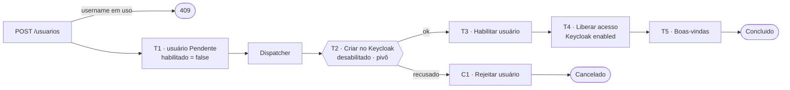

# Usuário com Keycloak: uma saga com Temporal

Exemplo da parte prática do tech talk sobre o **Saga Pattern**, desenhado como seria em produção.

**O problema.** Criar um usuário exige gravar no banco da aplicação **e** criar a identidade dele no Keycloak (no caso original, o Amazon Cognito). Nenhuma transação cobre os dois: se um der certo e o outro falhar, o usuário fica pela metade, e ele não pode conseguir fazer login antes de o processo inteiro terminar.

**A solução.** O `POST /usuarios` grava o usuário como `Pendente` e desabilitado. Daí em diante o provisionamento é uma saga orquestrada pelo [Temporal](https://temporal.io): ela cria a identidade no Keycloak **desabilitada**, habilita o usuário, só então libera o acesso (habilita a identidade no Keycloak) e envia as boas-vindas. O Temporal guarda o histórico, repete o que falhou por motivo técnico e, se o Keycloak recusar o usuário de vez, a saga o rejeita. Só existe o usuário: ele está habilitado ou não.

## O fluxo

Criar o usuário no banco local (T1) é um passo local e síncrono do `POST /usuarios`. Um username já em uso é recusado ali, com `409`, sem gravar nada e sem iniciar saga. A saga cobre o que o banco local não alcança, o Keycloak em diante:

| # | Passo | Tipo | Se falhar |
|---|---|---|---|
| T1 | Gravar o usuário na etapa `Pendente`, com `habilitado = false` (no `POST /usuarios`, fora da saga) | síncrono, local | username já usado: `409 username_em_uso`, nada é gravado |
| T2 | `CriarNoKeycloak`: criar a identidade no Keycloak com `enabled = false` | **pivô** | falha temporária: o Temporal tenta de novo. Username ou e-mail já existente no Keycloak: compensa com C1 |
| T3 | `HabilitarUsuario`: marcar `habilitado = true` no banco | repetível | o Temporal tenta de novo |
| T4 | `LiberarAcesso`: habilitar a identidade no Keycloak (`enabled = true`); só a partir daqui o login funciona | repetível | o Temporal tenta de novo |
| T5 | `EnviarBoasVindas`: enviar o e-mail de boas-vindas | repetível | o Temporal tenta de novo |
| C1 | `RejeitarUsuario`: gravar o motivo e manter `habilitado = false`; a saga termina em `Cancelado` | compensação do usuário criado no POST | o Temporal tenta de novo |



O histórico do usuário registra só os passos da saga. Caminho feliz: `CriandoIdentidade`, `HabilitandoUsuario`, `LiberandoAcesso`, `EnviandoBoasVindas`, `Concluido`. Recusa do Keycloak: `CriandoIdentidade`, `RejeitandoUsuario`, `Cancelado`.

**Liberado** é a identidade com `enabled = true` no Keycloak. Ela nasce desabilitada em T2 e só é habilitada em T4, perto do fim da saga: enquanto T4 não termina (inclusive quando ele repete por falha técnica), o login do usuário é recusado. Um usuário rejeitado nunca é habilitado.

O **perfil padrão** (papel `cliente`) não é um passo da saga: é o *default role* do realm, e o próprio Keycloak o aplica a todo usuário novo, mesmo desabilitado.

## O modelo: a tabela `usuarios`

O usuário é a única entidade do processo; o andamento da saga é parte dele. Uma tabela, `usuarios`:

| Coluna | Tipo | Regra |
|---|---|---|
| `id` | `text`, chave primária | é o id do usuário e o id do workflow no Temporal |
| `username` | `text` | índice único filtrado por `etapa <> 'Cancelado'` |
| `email`, `nome` | `text` | |
| `habilitado` | `bool` | `false` ao nascer; `true` em T3; sempre `false` no usuário rejeitado |
| `etapa` | `text`, indexada | `Pendente`, `Iniciado`, `CriandoIdentidade`, `HabilitandoUsuario`, `LiberandoAcesso`, `EnviandoBoasVindas`, `Concluido`, `RejeitandoUsuario`, `Cancelado` |
| `historico` | `jsonb` | a lista de etapas por que a saga passou, em ordem (`Pendente` e `Iniciado` não entram) |
| `motivo` | `text`, nulo | por que o usuário foi rejeitado |
| `keycloak_id` | `text`, nulo | o id da identidade no Keycloak, gravado ao passar de T2 |
| `criado_em` | `timestamptz` | |
| `xmin` | coluna do sistema do Postgres | versão da linha: é o *concurrency token* (propriedade sombra no EF) |

O usuário **rejeitado** é `habilitado = false`, `etapa = Cancelado` e `motivo` preenchido. O username de um usuário `Cancelado` volta a ficar livre.

Duas outras tabelas apoiam o exemplo: `envios` (`usuario_id`, `email`, `enviado_em`: evita mandar o e-mail de novo quando o Temporal repete T5) e `simulated_failures` (`id` = alvo, `remaining`: só para a demonstração).

## A API

| Rota | Resposta |
|---|---|
| `POST /usuarios` | `202` com `Location: /usuarios/{id}` e o estado do usuário no corpo; `409 username_em_uso`; `400 invalido` |
| `GET /usuarios/{id}` | `id`, `username`, `email`, `nome`, `habilitado`, `etapa`, `historico`, `motivo`, `keycloakId`; `404 nao_encontrado` |
| `DELETE /usuarios/{id}` | `204`; `409 provisionamento_em_andamento` enquanto a saga roda (etapa fora de `Concluido` e `Cancelado`); `404` |
| `POST /simulations/failures` | só em demonstração: `{"quantity": 2, "alvo": "keycloak-enable"}`; o alvo é opcional (`keycloak-create` por padrão); `204`; `400` para alvo desconhecido |

## Por que um serviço só, em dois containers

O provisionamento do usuário envolve dois recursos, o banco e o Keycloak. Quem orquestra é o dono do processo, o próprio serviço. Separar em microsserviços, pôr um broker no meio ou criar um serviço só para chamar a API do Keycloak acrescentaria rede, falhas e operação sem resolver nada a mais.

O serviço roda em **dois containers**, construídos da mesma solution:

| Container | Projeto | O que faz |
|---|---|---|
| `cadastro-web` | `CadastroService.Web` | A API REST: cria o usuário `Pendente` e desabilitado (T1), consulta e exclui, tudo no Postgres. Não conhece a saga nem o Temporal |
| `cadastro-worker` | `CadastroService.Worker` | O dispatcher (entrega os usuários pendentes à saga) e o worker do Temporal: busca as tarefas na task queue `provisionamento` e executa o workflow e as activities. Aplica as migrations ao subir |

Separar os dois permite escalar cada um conforme a carga: mais réplicas do worker não mudam nada na API, e o Temporal distribui as tarefas entre elas. A web fala só com o Postgres; o worker fala com o Postgres, o Temporal, o Keycloak e o SMTP. Os dois containers nunca falam entre si: a **tabela `usuarios` é o elo** entre eles (o POST grava o usuário `Pendente`; o dispatcher o lê).

O que importa na saga:

- **Estado da saga:** na própria tabela `usuarios` (etapa atual, histórico, motivo e id no Keycloak). Cada passo é gravado pela activity `RegistrarPasso`, e `GET /usuarios/{id}` lê essa tabela; a query do Temporal não é usada. O histórico de execução (tentativas, repetições) fica no Temporal e aparece na Temporal UI. A etapa também é a **trava semântica**: um usuário cuja saga ainda roda não pode ser excluído (409).
- **Retry:** política `StepPolicy` (`Application/Features/ProvisionarUsuario/StepPolicy.cs`): timeout de 30 s por passo e espera exponencial de 200 ms a 10 s, sem limite de tentativas para falhas técnicas. Só uma recusa de negócio (`StepRefusedException`) interrompe.
- **Idempotência:** o Temporal pode repetir uma activity. Se o Keycloak responder "já existe" com o mesmo username e e-mail, é uma tentativa anterior deste mesmo usuário, e ele segue. Habilitar a identidade no Keycloak é um PUT idempotente. O envio do e-mail é registrado para não repetir.
- **Username único:** um índice único (filtrado por `etapa <> 'Cancelado'`) garante um username por usuário cuja saga não foi cancelada. O `CriarUsuarioHandler` checa antes de gravar; na corrida entre dois POSTs com o mesmo username, o índice decide: o `EfUnitOfWork` traduz a violação (`SqlState` 23505 do Postgres) em `UniqueConstraintViolationException`, e o handler a converte em `409 username_em_uso`.
- **Concorrência otimista:** a coluna `xmin` do Postgres é a versão da linha. Duas gravações sobre a mesma versão: a segunda falha, em vez de sobrescrever a primeira.
- **Um usuário, um workflow:** o id do workflow é o id do usuário, então o mesmo usuário nunca é provisionado duas vezes. O dispatcher faz polling a cada 1 s com `FOR UPDATE SKIP LOCKED` sobre os usuários na etapa `Pendente`, então várias réplicas do worker nunca pegam o mesmo usuário.

## Como rodar

Pré-requisito: Docker com o Compose v2 e cerca de 3 GB de memória livres para o Docker.

```bash
docker compose up -d --build              # Postgres, Temporal, Temporal UI, Keycloak, Mailpit, cadastro-web e cadastro-worker
docker compose run --rm e2e               # 8 cenários ponta a ponta
docker compose run --rm integration-tests # concorrência otimista e username único contra o Postgres; o cliente do Keycloak (cria desabilitado, habilita)
docker compose down -v                    # desliga e apaga os dados
```

O primeiro `up` demora alguns minutos (os testes unitários rodam dentro do build). O Keycloak leva cerca de 30 segundos para ficar pronto.

### Rodar fora do Docker (`make`)

Para desenvolver com web e worker no Mac e só as dependências no Docker (alvos do `Makefile`; `make help` lista todos):

```bash
make infra        # Postgres, Temporal, Temporal UI, Keycloak e Mailpit no Docker
make run          # web (http://localhost:5090) e worker juntos
make watch        # o mesmo, com hot reload
make run-web      # só a API (WEB_URL muda a porta)
make run-worker   # só o worker (aplica as migrations ao subir)
make build        # compila a solution
make infra-down   # para as dependências
```

Os alvos `watch-web` e `watch-worker` rodam cada processo com hot reload. As `appsettings.json` de cada projeto apontam para `localhost`, então `make run` não precisa de variáveis. A web sobe em 5090 porque a 8080 do Mac está ocupada e a 8090 é do container `cadastro-web`.

### Testar à mão

```bash
curl -s -i -X POST localhost:8090/usuarios -H 'content-type: application/json' \
  -d '{"username":"ana","email":"ana@exemplo.com","nome":"Ana Souza"}'   # 202, Location: /usuarios/<id>, etapa Pendente, habilitado false
curl -s localhost:8090/usuarios/<id>             # etapa, historico e habilitado, lidos da tabela usuarios
curl -s -i -X POST localhost:8090/usuarios -H 'content-type: application/json' \
  -d '{"username":"ana","email":"outra@exemplo.com","nome":"Outra Ana"}'   # mesmo username: 409 {"erro":"username_em_uso",...}
curl -s -X POST localhost:8090/simulations/failures -H 'content-type: application/json' -d '{"quantity":2}'                             # o Keycloak falha ao criar
curl -s -X POST localhost:8090/simulations/failures -H 'content-type: application/json' -d '{"quantity":4,"alvo":"keycloak-enable"}'   # a identidade fica desabilitada enquanto T4 repete
```

Para ver a **compensação**, crie no console do Keycloak (realm *saga*) um usuário com um username qualquer e depois crie um usuário com esse mesmo username. Para ver o **usuário bloqueado durante a saga**, agende falhas em `keycloak-enable`, crie o usuário e consulte a identidade no console do Keycloak enquanto a etapa é `LiberandoAcesso`: ela existe com *Enabled* desligado.

O endpoint `/simulations/failures` existe só para a demonstração: faz o Keycloak "falhar" nas próximas N chamadas ao alvo, `keycloak-create` (T2) ou `keycloak-enable` (T4). Como quem recebe o pedido (web) e quem chama o Keycloak (worker) são containers diferentes, o contador fica numa tabela do Postgres, uma linha por alvo. Ele é ligado por `Simulations__Enabled` no compose e fica desligado por padrão.

## Onde olhar

| O quê | Endereço | Login |
|---|---|---|
| API | http://localhost:8090 | — |
| Temporal UI: histórico de cada usuário, tentativas e compensações | http://localhost:8233 | — |
| Keycloak (console de administração) | http://localhost:8180 | admin / admin (realm **saga**) |
| Mailpit (e-mails enviados) | http://localhost:8025 | — |

## Organização do código

Uma solution .NET com seis projetos em `src` e três de teste. O modelo é **híbrido**: os projetos da Clean Architecture ficam como camadas, e dentro de Application, Web e Worker o código se organiza por **vertical slices** (`Features/<Slice>/`). Infrastructure e Domain se organizam por tecnologia e por agregado. Regra de dependência, sempre para dentro: **Web e Worker → IoC → Infrastructure e Application → Domain** (o IoC referencia os dois). Web e Worker referenciam só o IoC. O Domain não depende de ninguém, e o Application não conhece o Infrastructure nem o IoC. O Infrastructure não referencia o Application: as portas que ele implementa moram no Domain, e o Application as consome. As entidades (`Usuario`, `Envio`, `SimulatedFailures`) moram no Domain; o EF mapeia o Domain direto, sem modelo de persistência paralelo, e a configuração de cada entidade fica em `Persistence/Configurations` (uma `IEntityTypeConfiguration` por entidade).

Duas fronteiras:

- **Só o Worker conhece o Temporal.** A lib `Temporalio` é referenciada apenas por `CadastroService.Worker`; Application, Infrastructure, IoC e Web não a referenciam.
- **Só a Web conhece endpoints HTTP.**

```
cadastro-service/
  CadastroService.slnx
  Dockerfile                     um build, dois alvos: --target web e --target worker
  src/
    Core/
      CadastroService.Domain/        por agregado: Usuarios/ (Usuario, Steps, UsuarioData, NovoUsuario, IUsuarioRepository),
                                     Envios/ (Envio, IEnvioRepository), Common/ (IUnitOfWork, ITransaction, DomainException, ConcurrencyConflictException,
                                     UniqueConstraintViolationException),
                                     Identity/ (IIdentityProvider, NewIdentity, IdentityProviderUser, IdentityAlreadyExistsException),
                                     Notifications/ (IEmailSender), Simulations/ (SimulatedFailures, ISimulatedFailures)
      CadastroService.Application/
        Features/                    um slice por caso de uso, com o handler e o que só ele usa:
          CriarUsuario/ ConsultarUsuario/ ExcluirUsuario/ SimularFalhas/   usados pela Web (CriarUsuario é o T1)
          CriarIdentidade/ HabilitarUsuario/ LiberarAcesso/ RejeitarUsuario/ EnviarBoasVindas/  chamados pelos passos da saga (T2 a T5 e C1)
          ProvisionarUsuario/        ProvisionarUsuarioSaga, IProvisionarUsuarioSteps, ISagaRunner, StepPolicy, StepRefusedException,
                                     ProvisionamentoDispatcher, RegistrarPassoHandler
    Infrastructure/
      CadastroService.Infrastructure/ Persistence/ (DbContext, Configurations, Repositories, Migrations), Identity/ (cliente do Keycloak),
                                     Email/ (SMTP), Simulations/ (simulação de falhas)
      CadastroService.IoC/           a injeção de dependências: AddCadastroWeb, AddCadastroWorker e ApplyMigrationsAsync
    Presentation/
      CadastroService.Web/
        Features/                    um endpoint por slice: CriarUsuario, ConsultarUsuario, ExcluirUsuario,
                                     Health, SimularFalhas; Common/ (UsuarioResponse)       → imagem cadastro-web
      CadastroService.Worker/
        Features/ProvisionarUsuario/ DispatcherService (o polling)                           → imagem cadastro-worker
          Temporal/                  o adaptador do Temporal: TemporalProvisionarUsuarioWorkflow, TemporalProvisionarUsuarioSteps, TemporalSagaRunner,
                                     ProvisionarUsuarioActivities, ProvisionarUsuarioWorker, TemporalConnection, TemporalExtensions, TemporalOptions,
                                     Saga e Activities (os nomes)
  tests/
    CadastroService.Domain.Tests/          regras do Usuario, do SimulatedFailures, do NovoUsuario e do NewIdentity (referencia só o Domain)
    CadastroService.Application.Tests/     CriarUsuarioHandler, ProvisionarUsuarioSaga (com fake de IProvisionarUsuarioSteps), CriarIdentidadeHandler, ExcluirUsuarioHandler (referencia só o Application)
    CadastroService.Infrastructure.Tests/  contra o Postgres: concorrência otimista e username único; o KeycloakClient com um HttpMessageHandler falso
infra/                           realm do Keycloak (com o default role) e init do Postgres
e2e/                             testes ponta a ponta (run.mjs)
Makefile                         alvos para rodar web e worker fora do Docker
```

Um slice não importa outro slice; o que é compartilhado vive no Domain (as portas e os tipos de `Usuarios/`, `Identity/`, `Notifications/` e `Simulations/`). Os handlers são classes simples, chamadas direto, sem mediator.

### Do POST ao usuário liberado

1. `POST /usuarios` → `CriarUsuarioEndpoint` (Web) → `CriarUsuarioHandler` (T1): checa o username (`IsUsernameInUse`) e grava o usuário `Pendente` e desabilitado (tabela `usuarios`) num `SaveChanges`. Responde `202` com o estado do usuário e o `Location`; username em uso (na checagem ou na corrida, via `UniqueConstraintViolationException`): `409 {"erro":"username_em_uso","mensagem":"O username <x> já está em uso"}`, sem gravar nada.
2. No worker, o `DispatcherService` roda a cada 1 s um ciclo do `ProvisionamentoDispatcher`: numa transação, `ClaimPending` pega os usuários `Pendente` com `FOR UPDATE SKIP LOCKED` e o `ISagaRunner` inicia a saga de cada um; depois o usuário é marcado `Iniciado`.
3. O `TemporalSagaRunner` inicia o workflow no Temporal com id igual ao `usuarioId`. Se o workflow já existe, é sucesso, não erro.
4. O `TemporalProvisionarUsuarioWorkflow` (fino) executa a `ProvisionarUsuarioSaga` do Application com os passos do `TemporalProvisionarUsuarioSteps`.
5. Cada passo vira uma activity do Temporal (`ProvisionarUsuarioActivities`), que chama o handler do slice correspondente (`CriarIdentidadeHandler`, `HabilitarUsuarioHandler`, `LiberarAcessoHandler`, `EnviarBoasVindasHandler`, `RejeitarUsuarioHandler`). O andamento é gravado pela activity `RegistrarPasso` (`RegistrarPassoHandler`) na própria linha do usuário.
6. `GET /usuarios/{id}` → `ConsultarUsuarioHandler` lê a tabela `usuarios`.

### O motor da saga é um adaptador

A `ProvisionarUsuarioSaga` (`Application/Features/ProvisionarUsuario/ProvisionarUsuarioSaga.cs`) é orquestração pura: só chama a porta `IProvisionarUsuarioSteps` e não conhece o motor que a executa.

| Peça | Papel |
|---|---|
| `IProvisionarUsuarioSteps` | porta: os passos da saga (T2 a T5, a compensação C1 e `RegistrarPasso`) |
| `ISagaRunner` | porta: inicia a saga de um usuário, de forma idempotente |
| `StepRefusedException` | recusa de negócio (o Keycloak recusou o usuário): não se repete; a saga compensa com C1 e cancela |
| `StepPolicy` | timeout e retry de cada passo |

O Temporal é um adaptador em `Worker/Features/ProvisionarUsuario/Temporal/`: `TemporalProvisionarUsuarioSteps` implementa a porta com `Workflow.ExecuteActivityAsync` (chamando as activities pelo nome, em `Activities`) e traduz o erro `Refused` em `StepRefusedException`; `TemporalSagaRunner` implementa o `ISagaRunner`; `TemporalProvisionarUsuarioWorkflow` liga a saga ao Temporal. Trocar de motor é escrever outro adaptador; a saga não muda. O teste `ProvisionarUsuarioSagaTests` roda a saga inteira com um fake da porta, sem Temporal.

**Regra de determinismo:** o Temporal reexecuta (replay) o código da saga para reconstruir o estado depois de uma queda. Por isso a `ProvisionarUsuarioSaga` não usa `DateTime.Now`, `Guid.NewGuid`, `Task.Run`, `Task.Delay` nem I/O direto; tudo que muda o mundo passa por `IProvisionarUsuarioSteps`.

## Referências

- Garcia-Molina, H.; Salem, K. *Sagas*. ACM SIGMOD, 1987.
- Richardson, C. *Microservices Patterns*, cap. 4. Manning, 2018. [microservices.io/patterns/data/saga](https://microservices.io/patterns/data/saga.html)
- [Documentação do Temporal](https://docs.temporal.io) · [Keycloak Admin REST API](https://www.keycloak.org/docs-api/latest/rest-api/index.html)
